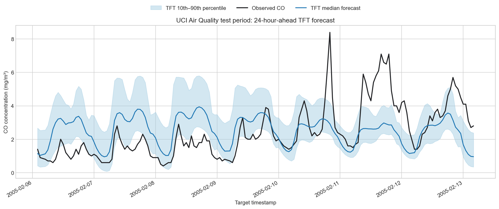

# Multi-horizon air-quality forecasting with TFT

This project forecasts the next 24 hourly carbon-monoxide measurements from the
previous 168 hours of UCI Air Quality observations. It uses the
`TemporalFusionTransformer` implementation in
[PyTorch Forecasting](https://pytorch-forecasting.readthedocs.io/); the TFT
architecture is not implemented from scratch here.

The repository is designed as a reproducible portfolio experiment: preprocessing,
training, checkpoint selection, held-out evaluation, machine-readable outputs, and
the notebook all use the same code path.



## Verified experiment

The committed experiment used seed 42 and stopped after 7 epochs. The checkpoint
from zero-based epoch 3 had the lowest validation quantile loss (`0.6208`). Test
data was not used for checkpoint or hyperparameter selection.

| Held-out test metric | TFT, all 24 horizons | Persistence baseline |
|---|---:|---:|
| MAE (mg/m³) | 1.1089 | 1.2028 |
| RMSE (mg/m³) | 1.3367 | 1.6435 |
| R² | -0.0284 | -0.5546 |
| Evaluated forecast points | 32,437 | 32,437 |

The TFT improves MAE by about 7.8% and RMSE by about 18.7% relative to the
same-origin persistence baseline. That does **not** make the model uniformly
strong: aggregate R² remains slightly negative. At a 1-hour horizon, R² is
`0.3173`; at 24 hours it is `-0.0913`. The nominal 80% interval between the
0.1 and 0.9 quantiles covers only 43.3% of evaluated points, so the interval is
under-calibrated and should not be presented as reliable uncertainty.

Metrics cover rolling forecasts whose decoder begins in the test period. A test
timestamp can therefore appear at several horizons. Missing CO labels have zero
weight and are excluded, leaving 32,437 forecast-origin/horizon pairs over 1,374
unique observed test timestamps. See
[`metrics.json`](artifacts/current/metrics.json),
[`metrics_by_horizon.csv`](artifacts/current/metrics_by_horizon.csv), and
[`test_predictions.csv`](artifacts/current/test_predictions.csv) for the exact
scope and values.

## Data and leakage controls

The included source files come from the
[UCI Air Quality dataset](https://archive.ics.uci.edu/dataset/360/air+quality),
which contains hourly measurements from March 2004 through April 2005. The target
is `CO(GT)`, the hourly reference-analyzer CO concentration in mg/m³.

- The CSV contains 9,357 valid hourly observations plus 114 empty trailing rows;
  only the empty rows are removed.
- UCI's `-200` sentinel is converted to missing. There are 1,683 missing CO
  targets and 7,674 observed CO targets.
- The time series is split in order: 6,549 train rows, 1,404 validation rows, and
  1,404 test rows. The periods do not overlap.
- Sensor inputs are forward-filled using past values only. Any leading gaps use
  medians fitted on the training period. `NMHC(GT)` is excluded because 8,443 of
  9,357 timestamped rows are missing.
- PyTorch Forecasting fits feature scalers/encoders on the training dataset.
  Validation and test datasets are created with `TimeSeriesDataSet.from_dataset`
  so they reuse training-fitted transformations.
- Calendar cycles and `time_idx` are future-known inputs. Sensor/analyzer readings,
  meteorological measurements, the target, and observation masks are unknown
  future inputs and are available only in the encoder.
- Missing CO values are causally filled so they can serve as historical context,
  but `target_weight=0` removes them from quantile loss and reported metrics.
- No timestamped row is deleted through IQR or other outlier filtering.

The exact split dates and train-fitted medians are recorded in
[`data_summary.json`](artifacts/current/data_summary.json).

## Model configuration

| Setting | Value |
|---|---:|
| Encoder history | 168 hours |
| Forecast horizon | 24 hours |
| Quantiles | 0.1, 0.5, 0.9 |
| Hidden size | 16 |
| Attention heads | 4 |
| Hidden continuous size | 8 |
| Dropout | 0.10 |
| Learning rate | 0.001 |
| Batch size | 128 |
| Maximum epochs / early-stop patience | 10 / 3 |

Point metrics use the median (`p50`) forecast. Checkpoint selection monitors
validation loss only. [`run_config.json`](artifacts/current/run_config.json)
records the tested package versions and full experiment configuration.

## Install and run

Python 3.11 or 3.12 is required. Commands below are run from the repository root.

```bash
git clone https://github.com/egemenozen1/pytorch-forecasting-tft.git
cd pytorch-forecasting-tft
python -m venv .venv
```

Activate the environment on Windows PowerShell:

```powershell
.\.venv\Scripts\Activate.ps1
```

Or on macOS/Linux:

```bash
source .venv/bin/activate
```

Install the tested dependencies and this package:

```bash
python -m pip install -r requirements-dev.txt
python -m pip install -e .
```

Validate the source data and run tests:

```bash
python -m air_quality_tft.cli data-summary
python -m pytest
```

Train, select the best validation checkpoint, and evaluate once on test:

```bash
python -m air_quality_tft.cli train
```

Evaluate an existing compatible Lightning checkpoint with its saved settings:

```bash
python -m air_quality_tft.cli evaluate \
  --config artifacts/current/run_config.json \
  --checkpoint artifacts/current/checkpoints/best.ckpt
```

The checkpoint directory is intentionally git-ignored because it is reproducible
and binary. A fresh training run creates it locally.

### Notebook

The executed notebook is [`notebooks/analysis.ipynb`](notebooks/analysis.ipynb).
It runs top-to-bottom as a compact analysis report using the verified artifacts.
Set `RUN_TRAINING = True` in its optional training cell to retrain from the same
pipeline.

```bash
python -m nbconvert --execute --to notebook --inplace notebooks/analysis.ipynb
```

## Outputs

| Path | Purpose |
|---|---|
| `artifacts/current/metrics.json` | Aggregate, baseline, and selected-horizon metrics |
| `artifacts/current/metrics_by_horizon.csv` | Metrics for each 1–24 hour horizon |
| `artifacts/current/test_predictions.csv` | Forecast origin, horizon, target, weights, and quantiles |
| `artifacts/current/forecast_vs_actual.png` | One week of 24-hour-ahead forecasts |
| `artifacts/current/run_config.json` | Seed, model/data settings, versions, and training record |
| `artifacts/current/data_summary.json` | Source coverage, split periods, and fitted medians |
| `artifacts/current/checkpoints/best.ckpt` | Local best-validation checkpoint; git-ignored |

## Legacy artifacts and repository size

The original experiment files are retained rather than silently deleted. They are
not current results:

- `notebooks/model_results/*.pth` are raw state dictionaries. They use different
  features, hidden dimensions, and seven output quantiles, and do not include a
  complete preprocessing configuration.
- old metric JSON files contain non-standard `NaN` R² values, while their
  prediction CSV files contain only one or two rows;
- 386 tracked Lightning log files occupy about 96 MB, including 72 distinct
  checkpoints. They have no exact duplicate checkpoint hashes, but they are
  historical experiment output rather than required runtime inputs.

See [`LEGACY_RESULTS.md`](notebooks/model_results/LEGACY_RESULTS.md). Future logs
and checkpoints are ignored. Removing the already tracked history would be a
separate repository-cleanup decision because it changes provenance and Git size.

## Limitations

- This is one monitoring site and roughly thirteen months of data; it does not
  establish geographic or long-term generalization.
- Overlapping rolling windows make the aggregate metric a forecast-point metric,
  not a count of independent timestamps. Per-horizon results are provided.
- Negative aggregate R² and weak interval coverage show substantial remaining
  model/calibration limitations.
- The repository is a reproducible experiment, not a production air-quality
  warning system.

## Attribution and licensing

Dataset citation: Vito, S. (2008). *Air Quality* [Dataset]. UCI Machine Learning
Repository. <https://doi.org/10.24432/C59K5F>. UCI lists the dataset under
CC BY 4.0. PyTorch Forecasting is MIT-licensed. Details are in
[`THIRD_PARTY_NOTICES.md`](THIRD_PARTY_NOTICES.md).

This repository did not previously declare a source-code license. The dataset's
license does not license the project code; the repository owner should choose a
code license before inviting reuse.


